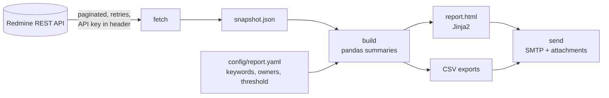

# Redmine Issue Reporter

[](https://github.com/NurMohammad126641/redmine-issue-reporter/actions/workflows/ci.yml)


**Automated weekly support-issue reporting from Redmine.** It pulls issues through the Redmine
REST API and sorts them into transactional and non-transactional work. It then summarises them
per owner, issue type and week, and emails management an HTML report with the detailed lists
attached as CSV. No one has to build the report by hand.

> **Where this comes from:** at TallyKhata (Progoti Systems) I wrote this to replace a manual
> weekly report on payment and app support tickets. This is a cleaned-up public version. Field
> names, teams and keywords live in a config file, credentials come only from the environment, and
> the bundled data is synthetic.

## What the report contains

- **KPI strip:** total issues, transactional vs non-transactional, still open, resolved today.
- **Transactional issues by owner and week:** add-money, money-out, recharge, cashback, card and
  QR failures, with one column per week and totals. Anything above the threshold is shown in red.
- **Non-transactional issues by owner and week:** login/OTP, app crashes, KYC, onboarding and
  similar.
- **Issue type by responsible team:** a matrix showing where the work lands.
- **Resolved today, by person:** read from the issue journals (who changed the status to
  *Resolved*).
- **CSV attachments:** full detail lists with direct links to each issue.

## How it works



Fetching and building are separate steps. The snapshot can be re-rendered, tested or debugged
without calling Redmine again, and `run` chains all three steps for a scheduler.

## Try it in one minute (no Redmine needed)

```bash
git clone https://github.com/NurMohammad126641/redmine-issue-reporter.git
cd redmine-issue-reporter
pip install -e ".[dev]"

issue-report demo --out report     # builds report/report.html and four CSVs from synthetic data
```

Open `report/report.html` in a browser. The demo data contains an incident week of mobile
recharge failures, so the red highlighting is visible. CI builds the same report on every push
and publishes it as a **[live sample report](https://nurmohammad126641.github.io/redmine-issue-reporter/)**.

## Using it with your Redmine

```bash
cp .env.example .env               # set REDMINE_URL, REDMINE_API_KEY and the SMTP settings
issue-report fetch                 # writes data/snapshot.json (git-ignored)
issue-report build                 # writes report/ (git-ignored)
issue-report send                  # emails report.html with the CSVs attached
issue-report run                   # all three, for cron or Windows Task Scheduler
```

Then edit [`config/report.yaml`](config/report.yaml) to match your custom field names, which
issue types count as transactional, which group owns which issue types, the assignee to report
on, and the highlight threshold.

## Security choices

- The API key is sent in the `X-Redmine-API-Key` header. It is never logged, and it never
  appears in the snapshot.
- TLS certificates are verified by default. Turning that off for a self-signed internal server
  is an explicit `REDMINE_VERIFY_SSL=false`.
- Snapshots and reports can contain real ticket data, so `data/` and `report/` are git-ignored.
- Issue text is HTML-escaped in the report (there is a test for it).
- CI runs a [gitleaks](https://github.com/gitleaks/gitleaks) secret scan on every push.

## Project layout

```text
config/report.yaml          what to include and how to group it
src/issue_reporter/
  cli.py                    demo / fetch / build / send / run
  redmine.py                API client: pagination, retries, custom fields, journals
  issues.py                 parsing and pandas summaries (weeks, categories, owners, teams)
  report.py                 HTML sections and CSV exports
  templates/report.html.j2  email-friendly HTML template
  mailer.py                 SMTP with STARTTLS and CSV attachments
  data/sample_snapshot.json synthetic demo data
tests/                      client, transformation, report and CLI tests
```

## Development

```bash
pytest
ruff check .
```

## Tech stack

Python · Redmine REST API · requests · pandas · Jinja2 · SMTP · pytest · GitHub Actions

## Author

**Nur Mohammad Siddiq**, Data, BI & Automation Engineer.
[LinkedIn](https://www.linkedin.com/in/nur-mohammad-siddiq-9a73931b6) · [GitHub](https://github.com/NurMohammad126641)
